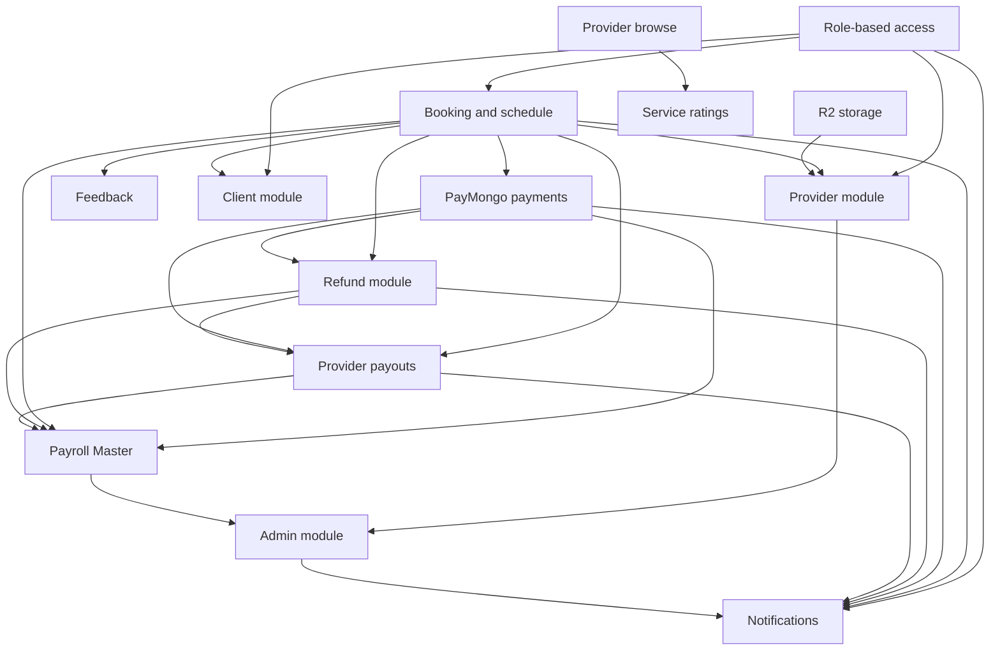

---
tags:
  - project/dependencies
updated: 2026-10-15
---

# Dependencies

Related notes: [[Architecture]] · [[Database]] · [[Modules]] · [[Development-Roadmap]]

## Feature dependency graph

## Explicit spec relationships

| Feature | Requires or is sequenced after | Consumers |
| --- | --- | --- |
| [[Features/20261009-role-based-access]] | None in its spec | All four role areas |
| [[Features/20261009-booking-schedule]] | Role-based access | Client, Provider, Payments, Refunds, Payouts, Feedback |
| [[Features/20261009-paymongo-payments]] | Booking tables and payment transitions | Client, Provider, Payroll, Refunds, Payouts |
| [[Features/20261009-refund-module]] | Booking, Payments, Role access | Client request UI; Payroll review UI; Payout eligibility |
| [[Features/20261009-provider-payouts]] | Booking, Payments, Refunds, Role access | Payroll review UI; Provider read-only view |
| [[Features/20261009-feedback-module]] | Booking and Role access | Client submission; Provider/client displays |
| [[Features/20261009-notifications]] | Role access and all event-producing modules | Every role dashboard |
| [[Features/20261009-payroll-master]] | Role access, Booking, Payments; later composes Refunds/Payouts | Admin separation-of-duties boundary |
| [[Features/20261009-admin-module]] | Role access, Provider, Payroll boundary | Provider/listing/account governance |
| [[Features/20261014-service-ratings]] | Provider Browse must pass review because both touch browse UI | Public browse/provider/service pages |

## Build order decision

ADR 0005 defines this proposed order: authentication → profiles/provider approval → service packages → schedules/bookings → payments → Payroll transactions → refunds → payouts → feedback → notifications/reports.

The current working tree contains some later UI slices before earlier relational modules. That is recorded honestly in [[Agent-Progress]]; it does not mean the database dependency has been satisfied.

## Runtime package dependencies

| Package | Responsibility |
| --- | --- |
| `next`, `react`, `react-dom` | Application runtime |
| `@clerk/nextjs`, `@clerk/react` | Clerk authentication and browser/server integration |
| `@supabase/supabase-js`, `@supabase/ssr` | Transitional Supabase Auth flows and hooks |
| `postgres` | Server-side PostgreSQL access |
| `aws4fetch` | Cloudflare R2 signed S3-compatible requests |
| `standardwebhooks` | Supabase email/SMS hook signature verification |
| `nodemailer` | Gmail SMTP delivery |
| `@base-ui/react`, `lucide-react`, `class-variance-authority`, `clsx`, `tailwind-merge` | UI primitives and composition |
| `@vercel/analytics` | Production analytics |
| `@electric-sql/pglite` | Embedded PostgreSQL testing |

No OCR dependency is installed. [[Features/20261014-provider-document-categories]] plans Tesseract.js but has no approved implementation plan yet.
